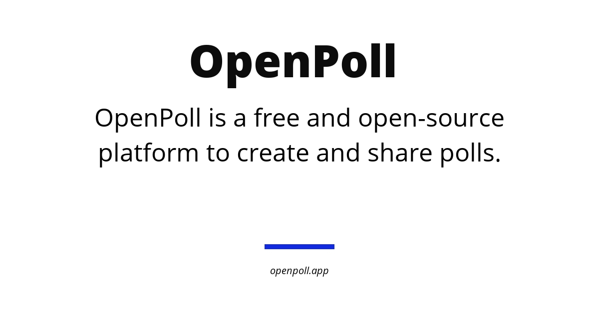

# OpenPoll



OpenPoll is a free and open-source application for creating and sharing polls. This fork targets a simple, single-server self-hosting setup with Astro, React, tRPC, Better Auth, Drizzle ORM, and a local libSQL/SQLite database. An external Turso database remains supported.

The original project is available on [GitHub](https://github.com/julianfbeck/openpoll.app).

## Requirements

- Node.js 22
- pnpm 9 (managed through Corepack)
- Docker with Docker Compose for container deployment

## Local development

```bash
corepack enable
pnpm install
cp .env.example .env
pnpm db:migrate
pnpm dev
```

Set `TURSO_URL` to a writable development path such as `file:./data/openpoll.db` when developing outside Docker. Generate a strong `BETTER_AUTH_SECRET` before starting the application.

## Configuration

| Variable | Purpose | Example |
| --- | --- | --- |
| `BETTER_AUTH_URL` | Public origin used by Better Auth and OAuth callbacks | `https://poll.example.ch` |
| `BETTER_AUTH_SECRET` | Secret used to sign authentication data | generated secret |
| `ALLOW_SIGNUP` | Enables email/password account registration when set to `true` | `true` for initial setup |
| `TURSO_URL` | Local libSQL file URL or remote Turso URL | `file:/data/openpoll.db` |
| `TURSO_AUTH_TOKEN` | Turso token; leave empty for a local file | empty |
| `GITHUB_CLIENT_ID` | Optional GitHub OAuth application client ID | empty |
| `GITHUB_CLIENT_SECRET` | Optional GitHub OAuth application secret | empty |
| `HOST` | Server bind address | `0.0.0.0` |
| `PORT` | Server port | `4321` |

Do not commit `.env` or production credentials. `BETTER_AUTH_URL` must match the address or domain actually used in the browser, including `https://` in production. Cookies are secure when this URL uses HTTPS and remain usable over HTTP on a local network.

### Initial local account

Start OpenPoll once with `ALLOW_SIGNUP=true`, open `/sign-up`, and create the first account. Email/password registration signs the new user in automatically. Afterwards set `ALLOW_SIGNUP=false` and restart the container. `/sign-up` then returns 404 while existing users can continue to sign in at `/sign-in`.

GitHub OAuth is optional. The provider is registered and displayed only when both GitHub variables are set. A local `file:` database does not use `TURSO_AUTH_TOKEN`.

## Docker

Copy the environment template, set at least a strong auth secret, and start the service:

```bash
cp .env.example .env
docker compose up -d --build
```

The container runs as the unprivileged `node` user, applies Drizzle migrations, and then starts the standalone Astro server on port 4321. The bind-mounted data directory is:

```text
./data/openpoll.db
```

Ensure that `./data` is writable by the container user. The same configuration accepts a remote `libsql://` Turso URL and token instead of the local file URL.

## GitHub OAuth

Configure the OAuth application with the same public origin as `BETTER_AUTH_URL`:

```text
Homepage URL:
https://poll.example.ch

Authorization callback URL:
https://poll.example.ch/api/auth/callback/github
```

GitHub login is disabled when either GitHub credential is empty. Email/password authentication remains available independently.

## Reverse proxy

Terminate HTTPS at the reverse proxy and forward traffic to port 4321. Forward the original host and protocol. Long-lived realtime connections must not be buffered and need an appropriately long read timeout.

```nginx
location / {
    proxy_pass http://openpoll:4321;
    proxy_http_version 1.1;

    proxy_set_header Host $host;
    proxy_set_header X-Forwarded-Host $host;
    proxy_set_header X-Forwarded-Proto $scheme;
    proxy_set_header X-Forwarded-For $proxy_add_x_forwarded_for;

    proxy_buffering off;
    proxy_cache off;
    proxy_read_timeout 3600s;
}
```

Set `BETTER_AUTH_URL` to the HTTPS public URL rather than the internal container address.

## Database migrations

Schema changes are generated and applied with Drizzle:

```bash
pnpm db:generate
pnpm db:migrate
```

The Docker entrypoint runs `drizzle-kit migrate` before every application start and exits immediately if a migration fails.

## Backup

Back up the complete `./data` directory. For a consistent SQLite backup, briefly stop OpenPoll or use SQLite's backup API. Litestream can be added later but is not part of this single-container setup.

## Current realtime limitation

The legacy Cloudflare Durable Object implementation remains in the repository for later replacement, but the Node runtime has no Durable Object binding. Realtime transport will be replaced separately; this phase does not alter poll or voting behavior.
